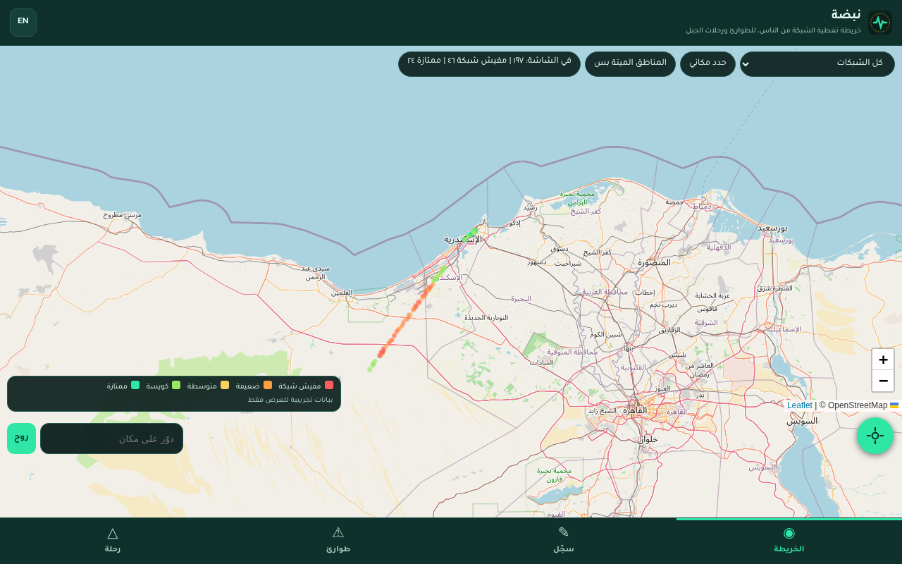
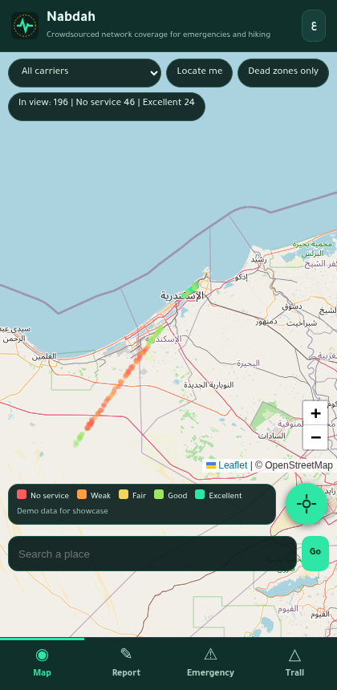
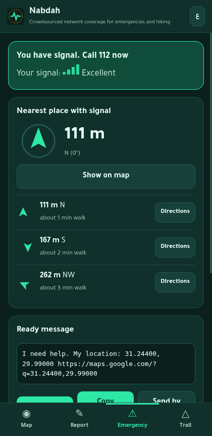
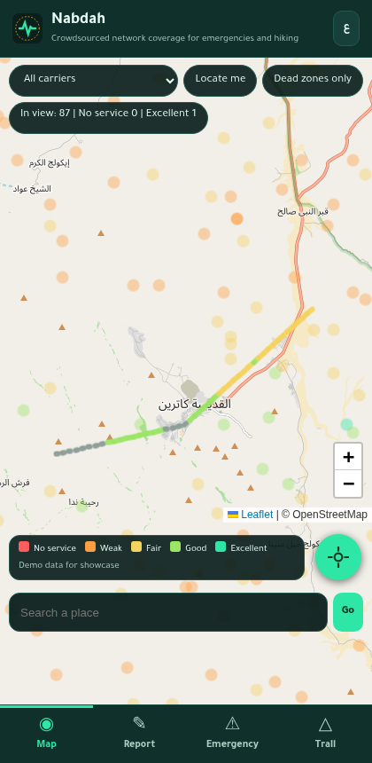
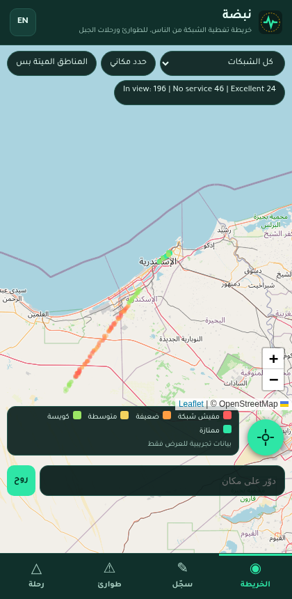
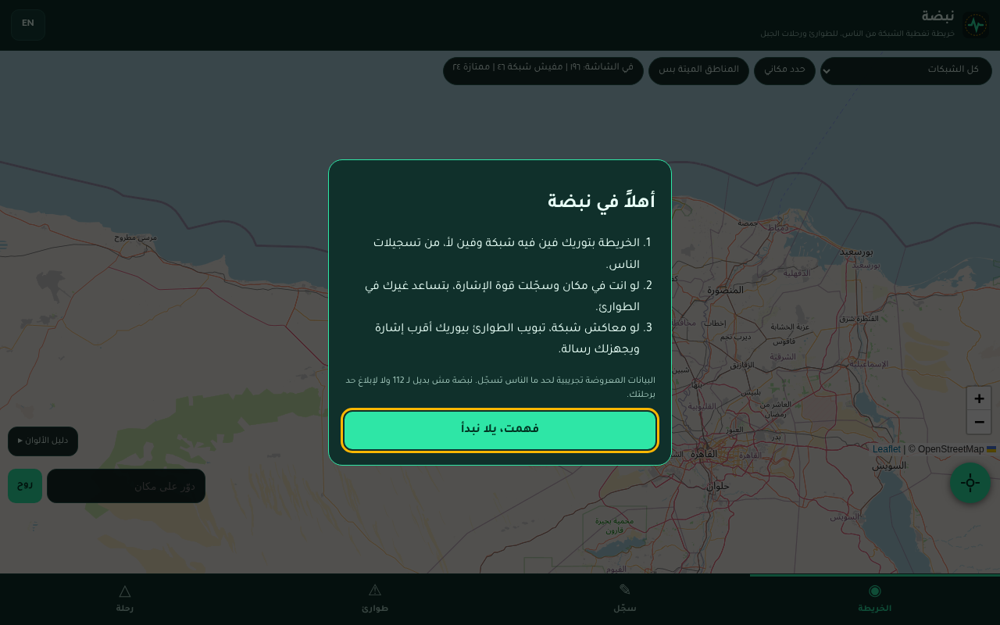
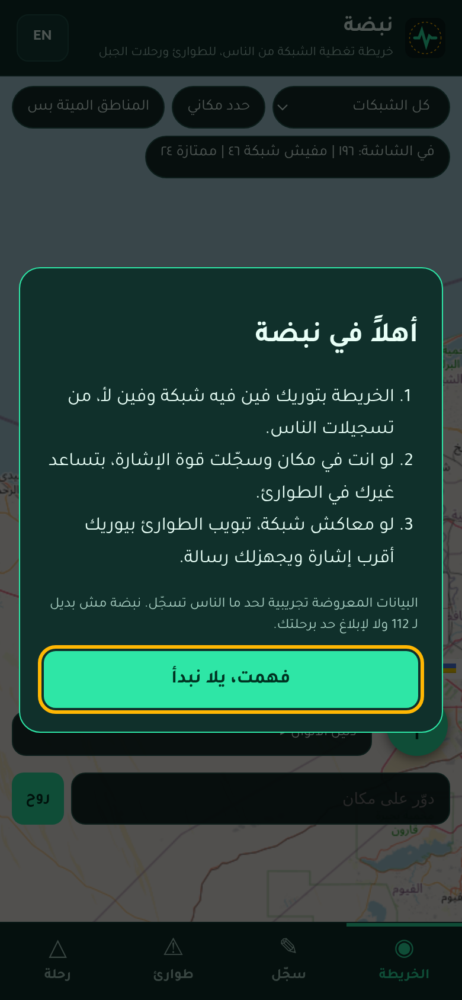

# Nabdah (نبضة)

**Crowdsourced network coverage map for emergencies and hiking. Free, no accounts, Arabic first.**

**Live demo: https://yousefkhames.github.io/nabdah/**



<p>




</p>

## Screenshots

Captured from the live site (https://yousefkhames.github.io/nabdah/).

<p>
  
  
</p>

## Why
When there is no signal, the first question is "where is the nearest place with signal?". Existing coverage maps are built around carrier marketing or tower databases. Nabdah is built around people: you report the bars you actually have, and the map, the emergency screen and the trail checker work from those reports.

## Features
- **Coverage map**: colour-coded cells from no service to excellent, carrier filter, dead-zone filter, place search, detail popup with carrier breakdown and confidence.
- **Two-tap reporting** plus a one-tap "no signal here" button: one report per spot, carrier and day. Readings are weighted by age and indoor/outdoor, outliers are trimmed, and popups name the best carrier once two or more reports back it. Review, delete, export, import or erase your own reports.
- **Emergency tab**: tells you if you have signal, shows the three nearest spots with signal (distance, compass direction, walking time, walking directions), prepares a message with your coordinates and battery level, and shares it by SMS or the share sheet. One-tap numbers for Egypt: 112, 122, 123.
- **Trail tab**: record a route offline, tag signal along it, see your longest dead stretch, export GPX.
- **Route check**: load a GPX file of a planned hike and see which parts of it have signal and where it drops (processed on your device).
- **Arabic and English**: right-to-left layout, Egyptian Arabic wording, Arabic digits and units, bidi-safe numbers.
- **Accessible**: tab and radio semantics, labelled controls, visible focus, live summary of the map view, reduced-motion support.
- **Installable PWA** with offline app shell and cached map tiles.

## Privacy
No accounts, no tracking. A report is snapped to a grid square of about 275 m and its time is cut to the day before it is stored. Your exact position is never saved by the app. Your own data stays in your browser unless you point the app at a server you run.

## Tech stack
Plain HTML, CSS and JavaScript (no build step), [Leaflet](https://leafletjs.com/) with OpenStreetMap tiles, a shared dependency-free core (`docs/core.js`) used by both the browser and the optional Node API (`server/server.js`), service worker for offline use.

## Run it
```bash
git clone https://github.com/yousefkhames/nabdah && cd nabdah
npx serve docs              # or any static file server
node test/test.js           # unit and API tests
node server/server.js       # optional report API (PORT, NABDAH_DATA)
```
To pool reports across users, host the API and set `window.NABDAH_API = "https://your-host"` in `docs/index.html`.

## Honest limits
- The map ships with **seeded demo data** (Alexandria, the Cairo-Alexandria desert road, St Catherine, Siwa), labelled in the legend. It becomes real only as people report.
- Browsers cannot read real signal bars, so reports are self-reported. A native Android app could sample the radio directly (roadmap).
- The GitHub Pages demo is static and local-first: reports are saved in your browser, not shared, until an API is hosted.
- Browsers pause GPS when the screen locks, so keep the page open while recording a trail.
- Nabdah is not a substitute for 112, a satellite messenger, or telling someone your route.

## Prior art
OpenCellID, TowerCollector, CoverageMap, Cell Surveys, LastBar. Nabdah differs by being free, Arabic first, privacy-snapped, and focused on "walk to signal" guidance and route checks.

## License
MIT


## Demo / portfolio project

Static GitHub Pages site. Data stays in your browser. Sample data is fictional and results are not professional, legal, medical or financial advice.

By Yousef Khames · من تطوير يوسف خميس
